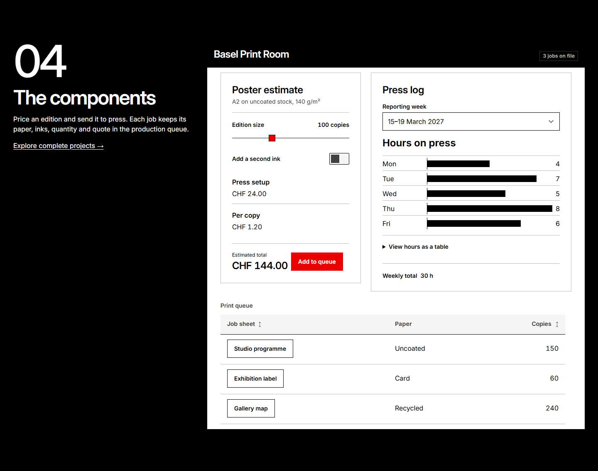

<!-- Generated from docs/readme.template.md and the public catalog by scripts/readme.mjs. -->


# Alpina UI

Open-source React components built on the Swiss typographic grid. Compose forms, tables and charts with a four-pixel rhythm, a measured type scale and one red accent.

[](https://github.com/stedbrown/alpina-ui/actions/workflows/ci.yml) [](LICENSE) [](CHANGELOG.md)

[Live site](https://alpinaui.com/) · [Start here](https://alpinaui.com/start-here/) · [Documentation](https://alpinaui.com/docs/) · [Designer kit](https://alpinaui.com/kit/) · [Design principles](https://alpinaui.com/principles/) · [Changelog](CHANGELOG.md) · [API stability](docs/api-stability.md)

| Light | Dark |
| --- | --- |
| [](docs/images/home-light.png) | [](docs/images/home-dark.png) |

The live poster lets you set type size and tracking, operate a print queue, compare paper and ink, and enlarge a keyboard-operated form to 400%. [Explore the specimens](https://alpinaui.com/)

## Install in 30 seconds

In an existing React 18.2 or 19 app, install the versioned archive and import the stylesheet once.

```sh
npm install https://alpinaui.com/alpina-ui-1.0.0-rc.5.tgz
```

```tsx
import { Button, CurrencyCHF } from 'alpina-ui'
import 'alpina-ui/styles.css'

export function Checkout() {
  return <Button type="submit">Pay <CurrencyCHF amount={24} locale="de-CH" /></Button>
}
```

To own the source, run `npx --no-install alpina add button`. To copy a complete page, use `npx --no-install alpina add block/dashboard`. Import `alpina-ui/fonts.css` for self-hosted Inter. Components establish the typeface even in a document with an unstyled body. A Tailwind v4 token bridge is also available. [Installation guide](https://alpinaui.com/docs/) · [CLI commands](https://alpinaui.com/docs/guides/cli/)

## What comes with Alpina

- Issue a Swiss QR-bill with a SIX payment section, or read an incoming slip locally from a file or camera and confirm the parsed data. Generate QRR or RF references and print a short invoice, itemized VAT and its payment slip on one A4 sheet. [QR-bill guide](https://alpinaui.com/docs/guides/qr-bill/)
- Collect an eCH-0010 postal address with offline postcode suggestions. Embed the address fields in an existing form or a configurable multi-step service. Use the same field and checksum rules for AHV, UID, IBAN and payment references in the browser and on the server. [Shared validation](https://alpinaui.com/docs/guides/validation/)
- Edit translations in German, French, Italian and Romansh side by side. English is also available in the public-service workflow and validation messages. Apply statutory or common holiday calendars by canton when calculating business days. [Language fields](https://alpinaui.com/docs/components/multilingual-field/) · [Swiss formats](https://alpinaui.com/docs/guides/swiss/)
- Build a booking calendar with day availability and cantonal holidays. Compare budget and actuals as grouped bars, multiple lines or printable accounting tables. [Calendar](https://alpinaui.com/docs/components/calendar/) · [Accounting tables](https://alpinaui.com/docs/components/data-table/)
- Lay out a page on four, eight or twelve columns. Inter’s optical sizes, tabular figures and a four-pixel baseline carry through to tables, print and dark mode. Export the tokens and printable sheets for design work. [Principles](https://alpinaui.com/principles/) · [Kit](https://alpinaui.com/kit/) · [Theme builder](https://alpinaui.com/themes/)
- Inspect a component’s keyboard behavior and screen-reader guidance alongside its source. CI checks interactions, automated accessibility, forced colors and visual regressions. [Reference](https://alpinaui.com/docs/components/) · [Testing](https://github.com/stedbrown/alpina-ui/blob/main/docs/visual-testing.md)

## Component directory

97 installable component entries and 5 copyable page blocks.

| Category | Entries |
| --- | --- |
| Base (51) | [Alert](https://alpinaui.com/docs/components/alert/) · [AppShell](https://alpinaui.com/docs/components/app-shell/) · [AspectRatio](https://alpinaui.com/docs/components/aspect-ratio/) · [Attachment](https://alpinaui.com/docs/components/attachment/) · [Avatar](https://alpinaui.com/docs/components/avatar/) · [Badge](https://alpinaui.com/docs/components/badge/) · [Breadcrumb](https://alpinaui.com/docs/components/breadcrumb/) · [Bubble](https://alpinaui.com/docs/components/bubble/) · [ButtonGroup](https://alpinaui.com/docs/components/button-group/) · [Button](https://alpinaui.com/docs/components/button/) · [Card](https://alpinaui.com/docs/components/card/) · [Checkbox](https://alpinaui.com/docs/components/checkbox/) · [CodeBlock](https://alpinaui.com/docs/components/code-block/) · [Collapsible](https://alpinaui.com/docs/components/collapsible/) · [DataTable](https://alpinaui.com/docs/components/data-table/) · [DescriptionList](https://alpinaui.com/docs/components/description-list/) · [Direction](https://alpinaui.com/docs/components/direction/) · [Empty](https://alpinaui.com/docs/components/empty/) · [Field](https://alpinaui.com/docs/components/field/) · [Figure](https://alpinaui.com/docs/components/figure/) · [FileInput](https://alpinaui.com/docs/components/file-input/) · [GridOverlay](https://alpinaui.com/docs/components/grid-overlay/) · [Grid](https://alpinaui.com/docs/components/grid/) · [Icon](https://alpinaui.com/docs/components/icon/) · [InputGroup](https://alpinaui.com/docs/components/input-group/) · [Input](https://alpinaui.com/docs/components/input/) · [Item](https://alpinaui.com/docs/components/item/) · [Kbd](https://alpinaui.com/docs/components/kbd/) · [Label](https://alpinaui.com/docs/components/label/) · [Marker](https://alpinaui.com/docs/components/marker/) · [Message](https://alpinaui.com/docs/components/message/) · [NavigationMenu](https://alpinaui.com/docs/components/navigation-menu/) · [Pagination](https://alpinaui.com/docs/components/pagination/) · [Progress](https://alpinaui.com/docs/components/progress/) · [Prose](https://alpinaui.com/docs/components/prose/) · [RadioGroup](https://alpinaui.com/docs/components/radio-group/) · [ScrollArea](https://alpinaui.com/docs/components/scroll-area/) · [Select](https://alpinaui.com/docs/components/select/) · [Separator](https://alpinaui.com/docs/components/separator/) · [Sidebar](https://alpinaui.com/docs/components/sidebar/) · [Skeleton](https://alpinaui.com/docs/components/skeleton/) · [Slider](https://alpinaui.com/docs/components/slider/) · [Spinner](https://alpinaui.com/docs/components/spinner/) · [Stack](https://alpinaui.com/docs/components/stack/) · [Steps](https://alpinaui.com/docs/components/steps/) · [Switch](https://alpinaui.com/docs/components/switch/) · [Table](https://alpinaui.com/docs/components/table/) · [TextLink](https://alpinaui.com/docs/components/text-link/) · [Textarea](https://alpinaui.com/docs/components/textarea/) · [Toggle](https://alpinaui.com/docs/components/toggle/) · [Typography](https://alpinaui.com/docs/components/typography/) |
| Interactive (23) | [Accordion](https://alpinaui.com/docs/components/accordion/) · [AlertDialog](https://alpinaui.com/docs/components/alert-dialog/) · [Carousel](https://alpinaui.com/docs/components/carousel/) · [Combobox](https://alpinaui.com/docs/components/combobox/) · [Command](https://alpinaui.com/docs/components/command/) · [ContextMenu](https://alpinaui.com/docs/components/context-menu/) · [Dialog](https://alpinaui.com/docs/components/dialog/) · [Drawer](https://alpinaui.com/docs/components/drawer/) · [DropdownMenu](https://alpinaui.com/docs/components/dropdown-menu/) · [HoverCard](https://alpinaui.com/docs/components/hover-card/) · [InputOTP](https://alpinaui.com/docs/components/input-otp/) · [Menubar](https://alpinaui.com/docs/components/menubar/) · [MessageScroller](https://alpinaui.com/docs/components/message-scroller/) · [NativeSelect](https://alpinaui.com/docs/components/native-select/) · [Popover](https://alpinaui.com/docs/components/popover/) · [Questionnaire](https://alpinaui.com/docs/components/questionnaire/) · [Resizable](https://alpinaui.com/docs/components/resizable/) · [Sheet](https://alpinaui.com/docs/components/sheet/) · [Tabs](https://alpinaui.com/docs/components/tabs/) · [Toast](https://alpinaui.com/docs/components/toast/) · [ToggleGroup](https://alpinaui.com/docs/components/toggle-group/) · [Tooltip](https://alpinaui.com/docs/components/tooltip/) · [Trace](https://alpinaui.com/docs/components/trace/) |
| Swiss (15) | [AhvInput](https://alpinaui.com/docs/components/ahv-input/) · [Calendar](https://alpinaui.com/docs/components/calendar/) · [CantonCombobox](https://alpinaui.com/docs/components/canton-combobox/) · [CantonSelect](https://alpinaui.com/docs/components/canton-select/) · [CurrencyCHF](https://alpinaui.com/docs/components/currency-chf/) · [DatePicker](https://alpinaui.com/docs/components/date-picker/) · [IbanInput](https://alpinaui.com/docs/components/iban-input/) · [LocaleSelect](https://alpinaui.com/docs/components/locale-select/) · [MultilingualField](https://alpinaui.com/docs/components/multilingual-field/) · [PhoneInput](https://alpinaui.com/docs/components/phone-input/) · [QrBillScanner](https://alpinaui.com/docs/components/qr-bill-scanner/) · [SwissAddressForm](https://alpinaui.com/docs/components/swiss-address-form/) · [SwissDate](https://alpinaui.com/docs/components/swiss-date/) · [SwissPostalCodeInput](https://alpinaui.com/docs/components/swiss-postal-code-input/) · [UidInput](https://alpinaui.com/docs/components/uid-input/) |
| Documents (3) | [InvoiceDocument](https://alpinaui.com/docs/components/invoice-document/) · [Letter](https://alpinaui.com/docs/components/letter/) · [SwissQrBill](https://alpinaui.com/docs/components/swiss-qr-bill/) |
| Charts (5) | [BarChart](https://alpinaui.com/docs/components/bar-chart/) · [ChartTable](https://alpinaui.com/docs/components/chart-table/) · [Chart](https://alpinaui.com/docs/components/chart/) · [LineChart](https://alpinaui.com/docs/components/line-chart/) · [Sparkline](https://alpinaui.com/docs/components/sparkline/) |
| Page blocks (5) | [Account settings](https://alpinaui.com/blocks/account-settings/) · [Dashboard](https://alpinaui.com/blocks/dashboard/) · [Login](https://alpinaui.com/blocks/login/) · [Pricing](https://alpinaui.com/blocks/pricing/) · [Public service](https://alpinaui.com/blocks/public-service/) |

## Alpina and shadcn/ui

| When choosing a library | Alpina UI | shadcn/ui |
| --- | --- | --- |
| Distribution | Versioned React package or editable TypeScript and CSS through the Alpina CLI. | Open component source installed through a CLI, with a registry ecosystem for sharing code. |
| Design starting point | A Swiss editorial grid, square corners and a restrained red, white and black palette. | Customizable styles and themes for building your own design system. |
| Application fit | Swiss address, identity, holiday and payment rules are part of the package. | A general-purpose starting point for teams choosing their own domain components and rules. |

Teams already using shadcn/ui can migrate one component family at a time. API differences and equivalents are documented. [Alpina migration table](https://alpinaui.com/docs/guides/migration/) · [shadcn/ui documentation](https://ui.shadcn.com/docs) · [shadcn registries](https://ui.shadcn.com/docs/registry)

## Build with Alpina

- [Interactive examples](https://alpinaui.com/examples/) and [framework integrations](integrations) cover Next.js, React Router and React Hook Form. The [offline catalog](https://alpinaui.com/catalog.html) includes source, API references and working previews.
- [Agent tools](https://alpinaui.com/agents/) include a local read-only MCP server and an installable skill. [Machine-readable site index](https://alpinaui.com/llms.txt)
- [Component status](https://alpinaui.com/status/), [Beta review](docs/beta-review.md), [0.x migration](docs/migrate-1-0.md) and the [1.0 checklist](docs/1.0-checklist.md) describe the contracts and remaining decisions.
- Run `npm ci`, `npm run build`, `npm run typecheck`, `npm test` and `npm run catalog` for a local build. Browser, bundle and performance checks are documented in the [quality guide](docs/package-quality.md). Maintainers can regenerate this README with `node scripts/readme.mjs`.

## Install the assistant skill

Run this in the project where your coding agent builds the interface.

```sh
npx skills add stedbrown/alpina-ui --skill alpina-ui
```

The skill covers composition, Swiss forms and payments. For exact prop names the companion MCP server reads the version installed in the application. [Agent setup](https://alpinaui.com/agents/)

## Site domain

`homepage` in `package.json` is the default public origin. The package build copies it into `registry.json`, which supplies the documentation URLs for the CLI and MCP server. The site build uses the same origin for canonical links, sharing cards, the sitemap, robots.txt, package downloads and the agent index.

Set `SITE_URL` to an HTTP(S) origin to build the site and its documentation links for another host. Configure it in Vercel or GitHub Actions for a hosted build. For a permanent move, update the package homepage and any configured overrides, regenerate the README with `node scripts/readme.mjs`, then rebuild the package and redeploy the site.

## License and data sources

Alpina’s original code and artwork use the MIT license. Inter is distributed under the SIL Open Font License. Locale data includes Unicode CLDR, postal localities are derived from ©swisstopo, and the local scanner includes jsQR and Mozilla PDF.js with their decoder notices. [MIT](LICENSE) · [Inter license](src/fonts/OFL.txt) · [Unicode license](docs/UNICODE-LICENSE.txt) · [swisstopo terms](https://www.swisstopo.admin.ch/en/terms-of-use-free-geodata-and-geoservices)
