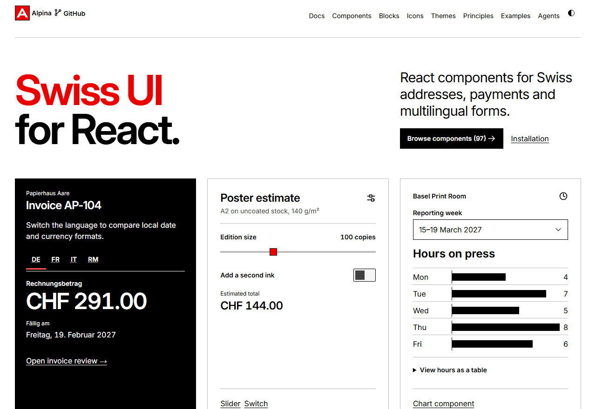

<!-- Generated from docs/readme.template.md and the public catalog by scripts/readme.mjs. -->


# Alpina UI

React components for Swiss software, from a multilingual address form to a printable QR-bill.

[](https://github.com/stedbrown/alpina-ui/actions/workflows/ci.yml) [](LICENSE) [](CHANGELOG.md)

[Live site](https://alpina-ui.vercel.app/) · [Documentation](https://alpina-ui.vercel.app/docs/) · [Designer kit](https://alpina-ui.vercel.app/kit/) · [Design principles](https://alpina-ui.vercel.app/principles/) · [Changelog](CHANGELOG.md) · [API stability](docs/api-stability.md)

| Light | Dark |
| --- | --- |
| [](docs/images/home-light.png) | [](docs/images/home-dark.png) |

## Install in 30 seconds

In an existing React 18.2 or 19 app, install the versioned archive and import the stylesheet once.

```sh
npm install https://alpina-ui.vercel.app/alpina-ui-1.0.0-rc.1.tgz
```

```tsx
import { Button, CurrencyCHF } from 'alpina-ui'
import 'alpina-ui/styles.css'

export function Checkout() {
  return <Button type="submit">Pay <CurrencyCHF amount={24} locale="de-CH" /></Button>
}
```

To own the source, run `npx --no-install alpina add button`. To copy a complete page, use `npx --no-install alpina add block/dashboard`. Optional imports include self-hosted Inter and a Tailwind v4 token bridge. [Installation guide](https://alpina-ui.vercel.app/docs/) · [CLI commands](https://alpina-ui.vercel.app/docs/guides/cli/)

## What comes with Alpina

- Issue a Swiss QR-bill with a SIX payment section, or read an incoming slip locally from a file or camera and confirm the parsed data. Print an invoice with itemized VAT and totals. [QR-bill guide](https://alpina-ui.vercel.app/docs/guides/qr-bill/)
- Collect an eCH-0010 postal address with offline postcode suggestions. Use the same field and checksum rules for AHV, UID, IBAN and payment references in the browser and on the server. [Shared validation](https://alpina-ui.vercel.app/docs/guides/validation/)
- Edit translations in German, French, Italian and Romansh side by side. English is also available in the public-service workflow and validation messages. Apply statutory or common holiday calendars by canton when calculating business days. [Language fields](https://alpina-ui.vercel.app/docs/components/multilingual-field/) · [Swiss formats](https://alpina-ui.vercel.app/docs/guides/swiss/)
- Lay out a page on four, eight or twelve columns. Inter’s optical sizes, tabular figures and a four-pixel baseline carry through to tables, print and dark mode. Export the tokens and printable sheets for design work. [Principles](https://alpina-ui.vercel.app/principles/) · [Kit](https://alpina-ui.vercel.app/kit/) · [Theme builder](https://alpina-ui.vercel.app/themes/)
- Inspect a component’s keyboard behavior and screen-reader guidance alongside its source. CI checks interactions, automated accessibility, forced colors and visual regressions. [Reference](https://alpina-ui.vercel.app/docs/components/) · [Testing](docs/visual-testing.md)

## Component directory

97 installable component entries and 5 copyable page blocks.

| Category | Entries |
| --- | --- |
| Base (51) | [Alert](https://alpina-ui.vercel.app/docs/components/alert/) · [AppShell](https://alpina-ui.vercel.app/docs/components/app-shell/) · [AspectRatio](https://alpina-ui.vercel.app/docs/components/aspect-ratio/) · [Attachment](https://alpina-ui.vercel.app/docs/components/attachment/) · [Avatar](https://alpina-ui.vercel.app/docs/components/avatar/) · [Badge](https://alpina-ui.vercel.app/docs/components/badge/) · [Breadcrumb](https://alpina-ui.vercel.app/docs/components/breadcrumb/) · [Bubble](https://alpina-ui.vercel.app/docs/components/bubble/) · [ButtonGroup](https://alpina-ui.vercel.app/docs/components/button-group/) · [Button](https://alpina-ui.vercel.app/docs/components/button/) · [Card](https://alpina-ui.vercel.app/docs/components/card/) · [Checkbox](https://alpina-ui.vercel.app/docs/components/checkbox/) · [CodeBlock](https://alpina-ui.vercel.app/docs/components/code-block/) · [Collapsible](https://alpina-ui.vercel.app/docs/components/collapsible/) · [DataTable](https://alpina-ui.vercel.app/docs/components/data-table/) · [DescriptionList](https://alpina-ui.vercel.app/docs/components/description-list/) · [Direction](https://alpina-ui.vercel.app/docs/components/direction/) · [Empty](https://alpina-ui.vercel.app/docs/components/empty/) · [Field](https://alpina-ui.vercel.app/docs/components/field/) · [Figure](https://alpina-ui.vercel.app/docs/components/figure/) · [FileInput](https://alpina-ui.vercel.app/docs/components/file-input/) · [GridOverlay](https://alpina-ui.vercel.app/docs/components/grid-overlay/) · [Grid](https://alpina-ui.vercel.app/docs/components/grid/) · [Icon](https://alpina-ui.vercel.app/docs/components/icon/) · [InputGroup](https://alpina-ui.vercel.app/docs/components/input-group/) · [Input](https://alpina-ui.vercel.app/docs/components/input/) · [Item](https://alpina-ui.vercel.app/docs/components/item/) · [Kbd](https://alpina-ui.vercel.app/docs/components/kbd/) · [Label](https://alpina-ui.vercel.app/docs/components/label/) · [Marker](https://alpina-ui.vercel.app/docs/components/marker/) · [Message](https://alpina-ui.vercel.app/docs/components/message/) · [NavigationMenu](https://alpina-ui.vercel.app/docs/components/navigation-menu/) · [Pagination](https://alpina-ui.vercel.app/docs/components/pagination/) · [Progress](https://alpina-ui.vercel.app/docs/components/progress/) · [Prose](https://alpina-ui.vercel.app/docs/components/prose/) · [RadioGroup](https://alpina-ui.vercel.app/docs/components/radio-group/) · [ScrollArea](https://alpina-ui.vercel.app/docs/components/scroll-area/) · [Select](https://alpina-ui.vercel.app/docs/components/select/) · [Separator](https://alpina-ui.vercel.app/docs/components/separator/) · [Sidebar](https://alpina-ui.vercel.app/docs/components/sidebar/) · [Skeleton](https://alpina-ui.vercel.app/docs/components/skeleton/) · [Slider](https://alpina-ui.vercel.app/docs/components/slider/) · [Spinner](https://alpina-ui.vercel.app/docs/components/spinner/) · [Stack](https://alpina-ui.vercel.app/docs/components/stack/) · [Steps](https://alpina-ui.vercel.app/docs/components/steps/) · [Switch](https://alpina-ui.vercel.app/docs/components/switch/) · [Table](https://alpina-ui.vercel.app/docs/components/table/) · [TextLink](https://alpina-ui.vercel.app/docs/components/text-link/) · [Textarea](https://alpina-ui.vercel.app/docs/components/textarea/) · [Toggle](https://alpina-ui.vercel.app/docs/components/toggle/) · [Typography](https://alpina-ui.vercel.app/docs/components/typography/) |
| Interactive (23) | [Accordion](https://alpina-ui.vercel.app/docs/components/accordion/) · [AlertDialog](https://alpina-ui.vercel.app/docs/components/alert-dialog/) · [Carousel](https://alpina-ui.vercel.app/docs/components/carousel/) · [Combobox](https://alpina-ui.vercel.app/docs/components/combobox/) · [Command](https://alpina-ui.vercel.app/docs/components/command/) · [ContextMenu](https://alpina-ui.vercel.app/docs/components/context-menu/) · [Dialog](https://alpina-ui.vercel.app/docs/components/dialog/) · [Drawer](https://alpina-ui.vercel.app/docs/components/drawer/) · [DropdownMenu](https://alpina-ui.vercel.app/docs/components/dropdown-menu/) · [HoverCard](https://alpina-ui.vercel.app/docs/components/hover-card/) · [InputOTP](https://alpina-ui.vercel.app/docs/components/input-otp/) · [Menubar](https://alpina-ui.vercel.app/docs/components/menubar/) · [MessageScroller](https://alpina-ui.vercel.app/docs/components/message-scroller/) · [NativeSelect](https://alpina-ui.vercel.app/docs/components/native-select/) · [Popover](https://alpina-ui.vercel.app/docs/components/popover/) · [Questionnaire](https://alpina-ui.vercel.app/docs/components/questionnaire/) · [Resizable](https://alpina-ui.vercel.app/docs/components/resizable/) · [Sheet](https://alpina-ui.vercel.app/docs/components/sheet/) · [Tabs](https://alpina-ui.vercel.app/docs/components/tabs/) · [Toast](https://alpina-ui.vercel.app/docs/components/toast/) · [ToggleGroup](https://alpina-ui.vercel.app/docs/components/toggle-group/) · [Tooltip](https://alpina-ui.vercel.app/docs/components/tooltip/) · [Trace](https://alpina-ui.vercel.app/docs/components/trace/) |
| Swiss (15) | [AhvInput](https://alpina-ui.vercel.app/docs/components/ahv-input/) · [Calendar](https://alpina-ui.vercel.app/docs/components/calendar/) · [CantonCombobox](https://alpina-ui.vercel.app/docs/components/canton-combobox/) · [CantonSelect](https://alpina-ui.vercel.app/docs/components/canton-select/) · [CurrencyCHF](https://alpina-ui.vercel.app/docs/components/currency-chf/) · [DatePicker](https://alpina-ui.vercel.app/docs/components/date-picker/) · [IbanInput](https://alpina-ui.vercel.app/docs/components/iban-input/) · [LocaleSelect](https://alpina-ui.vercel.app/docs/components/locale-select/) · [MultilingualField](https://alpina-ui.vercel.app/docs/components/multilingual-field/) · [PhoneInput](https://alpina-ui.vercel.app/docs/components/phone-input/) · [QrBillScanner](https://alpina-ui.vercel.app/docs/components/qr-bill-scanner/) · [SwissAddressForm](https://alpina-ui.vercel.app/docs/components/swiss-address-form/) · [SwissDate](https://alpina-ui.vercel.app/docs/components/swiss-date/) · [SwissPostalCodeInput](https://alpina-ui.vercel.app/docs/components/swiss-postal-code-input/) · [UidInput](https://alpina-ui.vercel.app/docs/components/uid-input/) |
| Documents (3) | [InvoiceDocument](https://alpina-ui.vercel.app/docs/components/invoice-document/) · [Letter](https://alpina-ui.vercel.app/docs/components/letter/) · [SwissQrBill](https://alpina-ui.vercel.app/docs/components/swiss-qr-bill/) |
| Charts (5) | [BarChart](https://alpina-ui.vercel.app/docs/components/bar-chart/) · [ChartTable](https://alpina-ui.vercel.app/docs/components/chart-table/) · [Chart](https://alpina-ui.vercel.app/docs/components/chart/) · [LineChart](https://alpina-ui.vercel.app/docs/components/line-chart/) · [Sparkline](https://alpina-ui.vercel.app/docs/components/sparkline/) |
| Page blocks (5) | [Account settings](https://alpina-ui.vercel.app/blocks/account-settings/) · [Dashboard](https://alpina-ui.vercel.app/blocks/dashboard/) · [Login](https://alpina-ui.vercel.app/blocks/login/) · [Pricing](https://alpina-ui.vercel.app/blocks/pricing/) · [Public service](https://alpina-ui.vercel.app/blocks/public-service/) |

## Alpina and shadcn/ui

| When choosing a library | Alpina UI | shadcn/ui |
| --- | --- | --- |
| Distribution | Versioned React package or editable TypeScript and CSS through the Alpina CLI. | Open component source installed through a CLI, with a registry ecosystem for sharing code. |
| Design starting point | A Swiss editorial grid, square corners and a restrained red, white and black palette. | Customizable styles and themes for building your own design system. |
| Application fit | Swiss address, identity, holiday and payment rules are part of the package. | A general-purpose starting point for teams choosing their own domain components and rules. |

Teams already using shadcn/ui can migrate one component family at a time. API differences and equivalents are documented. [Alpina migration table](https://alpina-ui.vercel.app/docs/guides/migration/) · [shadcn/ui documentation](https://ui.shadcn.com/docs) · [shadcn registries](https://ui.shadcn.com/docs/registry)

## Build with Alpina

- [Interactive examples](https://alpina-ui.vercel.app/examples/) and [framework integrations](integrations) cover Next.js, React Router and React Hook Form. The [offline catalog](https://alpina-ui.vercel.app/catalog.html) includes source, API references and working previews.
- [Agent tools](https://alpina-ui.vercel.app/agents/) include a local read-only MCP server and an installable skill. [Machine-readable site index](https://alpina-ui.vercel.app/llms.txt)
- [Component status](https://alpina-ui.vercel.app/status/), [Beta review](docs/beta-review.md), [0.x migration](docs/migrate-1-0.md) and the [1.0 checklist](docs/1.0-checklist.md) describe the contracts and remaining decisions.
- Run `npm ci`, `npm run build`, `npm run typecheck`, `npm test` and `npm run catalog` for a local build. Browser, bundle and performance checks are documented in the [quality guide](docs/package-quality.md). Maintainers can regenerate this README with `node scripts/readme.mjs`.

## Site domain

Set `SITE_URL` to your HTTPS origin in the Vercel production environment and in the GitHub Actions repository variables. Use that value locally with `npm run catalog` and `node scripts/readme.mjs`, then commit the generated README. With the variable unset, the build uses the package homepage. Redeploy after a domain change so canonical links, the sharing card, sitemap, robots file and machine-readable index advertise the new address.

## License and data sources

Alpina’s original code and artwork use the MIT license. Inter is distributed under the SIL Open Font License. Locale data includes Unicode CLDR, postal localities are derived from ©swisstopo, and the local scanner includes jsQR and Mozilla PDF.js with their decoder notices. [MIT](LICENSE) · [Inter license](src/fonts/OFL.txt) · [Unicode license](docs/UNICODE-LICENSE.txt) · [swisstopo terms](https://www.swisstopo.admin.ch/en/terms-of-use-free-geodata-and-geoservices)
