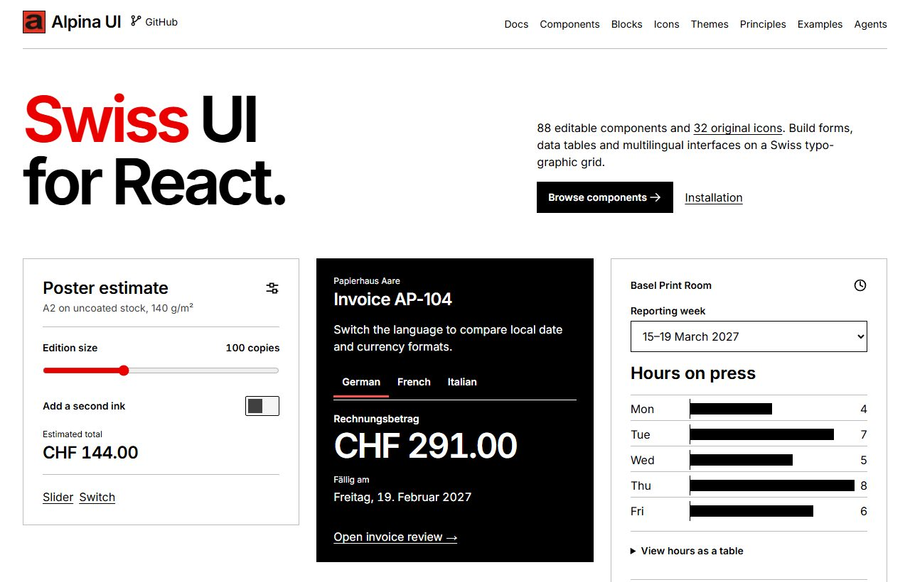
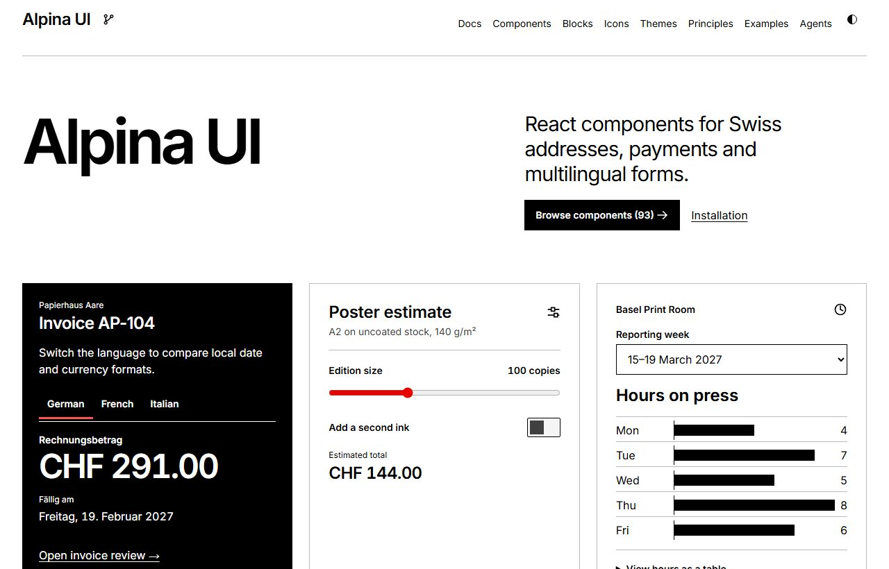
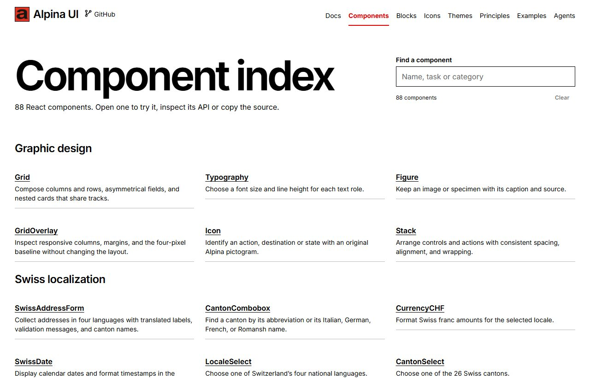
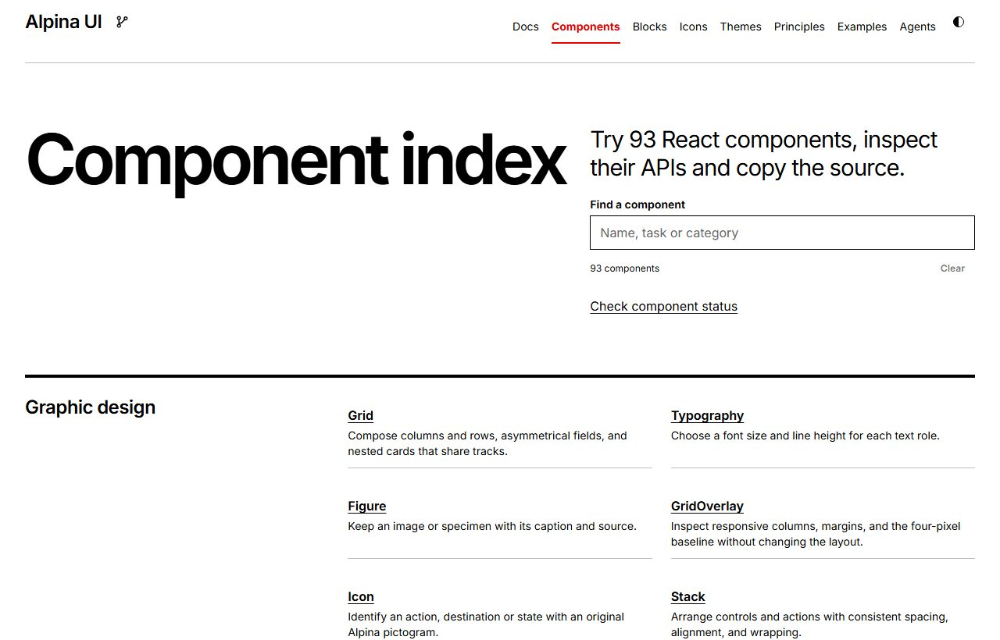
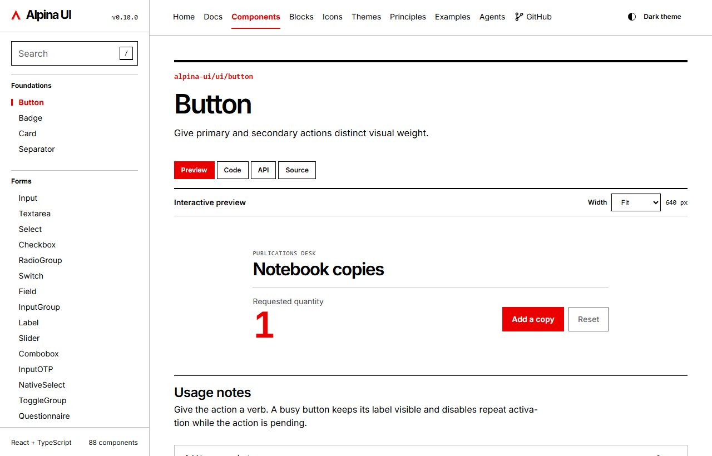
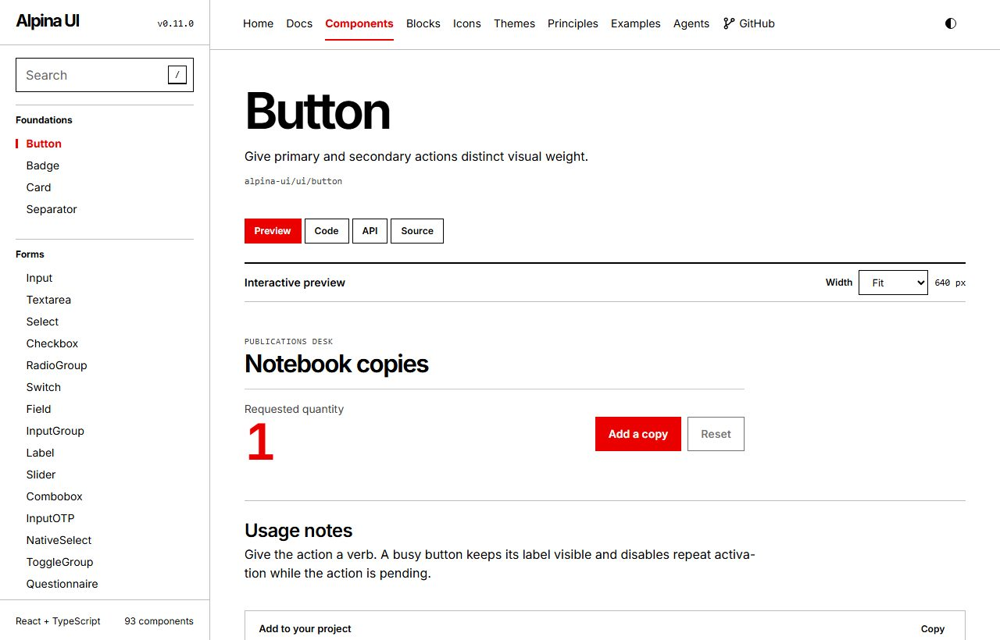

# Portal design in Alpina UI 0.11.0

The portal now uses a common opening for its indexes and tools. At desktop width, the title starts on column one and the introduction on column eight. On a phone, the introduction follows the title in reading order on the same left edge. These comparisons show the live interfaces in Chromium at 1280 × 820 CSS pixels.

## Homepage

The product name and its purpose now occupy separate columns. The multilingual invoice comes first in the examples, where visitors can switch language and see a Swiss amount and date together. The estimate and press log use the same row height. The wordmark, GitHub link, menu and appearance control each have their own target in the compact masthead.

| 0.10.0 | 0.11.0 |
| --- | --- |
|  |  |

## Component index

A category name holds the first four columns. Two lists of matching entries occupy the remaining eight. The shared row tracks carry each rule across descriptions of different lengths. Search, result count and the link to component status sit together. On a phone each group becomes a single list.

| 0.10.0 | 0.11.0 |
| --- | --- |
|  |  |

## Component reference

The component name comes first. The import path follows the description in smaller type. The title, preview controls, working example and usage notes all begin on the same column. Changing the preview width keeps this edge fixed, which makes it easier to compare wrapping and alignment.

| 0.10.0 | 0.11.0 |
| --- | --- |
|  |  |

The same review covered the guides, theme builder, icon directory, principles, component status, examples and copyable page blocks. The workshop and sign-in headings now share the form grid. The client address book gives the postal address the full width formerly occupied by a decorative engraving.
